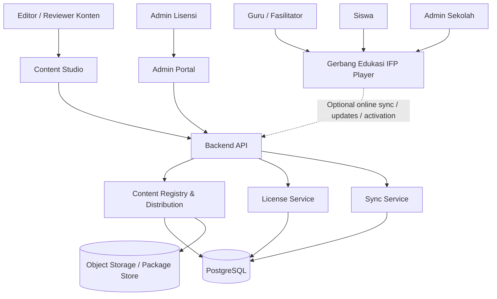
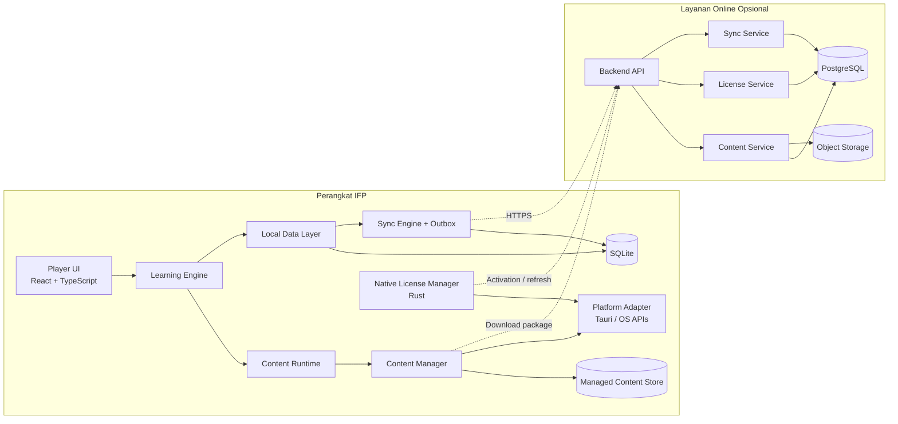
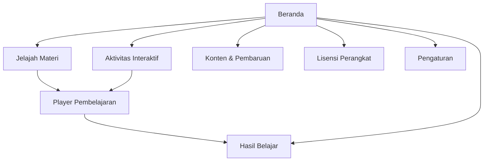

# HLD --- High-Level Design

## Gerbang Edukasi -- IFP Apps

**Versi:** 1.1\
**Status:** Draft arsitektur untuk review; spesifikasi UI/UX ditambahkan pada versi ini\
**Tanggal:** 23 Oktober 2026\
**Platform target:** Android 14+ dan Windows 11; RAM minimum 8 GB;
penyimpanan internal minimum 128 GB; Full HD dan 4K.

------------------------------------------------------------------------

## 1. Tujuan dokumen

Dokumen ini menetapkan arsitektur tingkat tinggi Gerbang Edukasi -- IFP
Apps sebagai dasar implementasi tim dan coding agent. Dokumen
menjelaskan batas sistem, komponen, aliran data, teknologi kandidat,
deployment, keamanan, serta keputusan yang masih harus divalidasi.

Dokumen ini **bukan bukti bahwa aplikasi sudah dibangun atau diuji**.
Semua klaim kompatibilitas platform yang belum diuji pada perangkat
target tetap berstatus `VALIDATE`.

## 2. Ringkasan produk

Gerbang Edukasi -- IFP Apps adalah platform pembelajaran interaktif
untuk SD kelas 1--6, digunakan melalui Interactive Flat Panel (IFP).
Aplikasi mendukung mode pembelajaran dipandu guru dan mode belajar
mandiri siswa, serta materi, aktivitas interaktif, game, kuis, evaluasi,
dan konten multimedia.

### Keputusan produk yang sudah ditetapkan

-   Target penggunaan internal dan komersial.
-   Tidak mewajibkan akun online untuk belajar.
-   Profil, sesi, progres, dan hasil belajar dapat disimpan lokal.
-   Sinkronisasi cloud opsional saat jaringan tersedia.
-   Pembaruan konten melalui impor lokal/USB dan unduhan online.
-   Lisensi perpetual dan subscription; aktivasi online maupun offline;
    satu serial per perangkat.
-   Fitur awal berfokus pada player, aktivitas, game, kuis, evaluasi,
    dan laporan dasar; bukan LMS tingkat lanjut.
-   Konten lengkap kelas 1--6 dan seluruh mata pelajaran dalam cakupan
    rilis harus tersedia pada peluncuran.
-   Konten bawaan ikut paket instalasi/build; konten yang dikelola
    pengguna berada pada app-data repository.
-   Nama tampilan dapat diubah tanpa mengubah identitas teknis produk.

## 3. Sasaran arsitektur

1.  Pembelajaran inti tetap berjalan tanpa internet.
2.  Windows dan Android berbagi model konten serta kontrak domain yang
    sama.
3.  Konten dapat diperbarui tanpa membangun ulang aplikasi player.
4.  Paket konten yang rusak atau tidak kompatibel tidak merusak konten
    aktif.
5.  Hasil belajar tidak hilang ketika jaringan terputus atau aplikasi
    ditutup mendadak.
6.  Lisensi divalidasi pada native layer dengan tanda tangan digital.
7.  Modul dapat dikerjakan terpisah oleh coding agent melalui kontrak
    eksplisit.
8.  Keamanan, privasi, aksesibilitas, dan validasi pedagogis menjadi
    bagian dari alur rilis.

## 4. Diagram konteks sistem

Pembelajaran lokal tidak bergantung pada keberhasilan koneksi ke Backend
API. Fungsi online digunakan hanya untuk layanan yang memang
memerlukannya, seperti unduhan paket, sinkronisasi, aktivasi online, dan
administrasi terpusat.

## 5. Diagram container dan batas sistem

## 6. Komponen utama

### 6.1 IFP Player

Tanggung jawab: - Navigasi fase, kelas, mata pelajaran, unit, dan
materi. - Mode guru dan mode siswa mandiri. - UI touch-first untuk layar
besar. - Pemutaran teks, gambar, audio, video, dan aktivitas
interaktif. - Menampilkan hasil dan feedback belajar. - Menampilkan
status paket dan lisensi tanpa menjadikan UI sebagai sumber otoritatif.

### 6.2 Learning Engine

Tanggung jawab: - Menjalankan aktivitas dari registry tipe aktivitas
yang diizinkan. - Mengelola lifecycle sesi dan percobaan. - Menghitung
skor berdasarkan aturan asesmen yang tervalidasi. - Mengirim hasil ke
Local Data Layer. - Menyediakan feedback sesuai usia dan kebutuhan
aksesibilitas.

Batas: tidak mengeksekusi kode arbitrer yang berasal dari paket konten.

### 6.3 Content Runtime dan Content Manager

Content Runtime memilih versi konten aktif dan menyajikan aset untuk
Learning Engine. Content Manager menangani: - Impor paket lokal. -
Pengunduhan paket online. - Validasi manifest, schema, hash, ukuran,
dependensi, dan kompatibilitas. - Ekstraksi aman ke staging. - Aktivasi
versi secara atomik. - Rollback jika aktivasi gagal. -
Penonaktifan/penghapusan paket tambahan dengan pemeriksaan dependensi.

Konten bawaan bersifat recoverable. Paket inti tidak dihapus secara
permanen melalui operasi normal. Folder `public/` pada source/build
bukan tempat penyimpanan yang diasumsikan dapat diedit pengguna.

### 6.4 Local Data Layer

-   Menyimpan profil lokal, sesi, percobaan aktivitas, respons evaluasi,
    progres, dan outbox.
-   Menggunakan SQLite dengan migrasi bernomor.
-   Menulis hasil belajar dan event outbox dalam transaksi yang sama.
-   Menyediakan backup/restore yang diuji.
-   Meminimalkan data pribadi siswa.

### 6.5 Sync Engine

-   Sinkronisasi opsional.
-   Mengirim event dengan ID unik dan schema version.
-   Mendukung retry/backoff, acknowledgement per event, dan idempotency.
-   Tidak menghapus event sebelum acknowledgement tersimpan.
-   Menjaga respons evaluasi historis bersifat append-only.
-   Tidak menghentikan pembelajaran jika sinkronisasi gagal.

### 6.6 Native License Manager

-   Dibangun pada Rust/native layer.
-   Menghasilkan installation ID acak yang persisten.
-   Memverifikasi signature lisensi, product ID, device binding, waktu,
    dan entitlement.
-   Mendukung aktivasi online serta impor/ekspor file aktivasi offline.
-   Menyimpan lisensi terpisah dari konten dan hasil belajar.
-   Private signing key tidak pernah disertakan pada aplikasi klien.
-   Offline revocation tidak dapat diterapkan seketika; kebijakan ini
    harus transparan.

### 6.7 Content Studio

-   Menyusun metadata kurikulum, unit, materi, aktivitas, asesmen, dan
    aset.
-   Mendukung draft lokal ketika offline.
-   Menjalankan validasi paket sebelum publikasi.
-   Menyediakan workflow draft → review → approved → package build →
    publish.
-   Tidak mengizinkan konten menambahkan kode native arbitrer.

### 6.8 Admin Portal

-   Mengelola katalog dan versi konten.
-   Mengatur reviewer dan persetujuan.
-   Mengelola distribusi paket dan status rilis.
-   Mengelola serial, aktivasi, transfer, dan audit lisensi.
-   Menggunakan kontrol akses berbasis peran untuk fungsi administratif.

### 6.9 Backend API dan layanan domain

Untuk tahap awal gunakan modular monolith dengan batas domain: - Content
Registry/Distribution. - License Service. - Sync Service. - Admin/API
authorization. - Audit dan diagnostics.

Pisahkan deployment menjadi microservices hanya jika kebutuhan skala,
keamanan, atau operasional membenarkannya.

## 7. Stack teknologi kandidat

  -----------------------------------------------------------------------
  Lapisan                 Kandidat                Status
  ----------------------- ----------------------- -----------------------
  App shell               Tauri 2 + Rust          VALIDATE pada perangkat
  Windows/Android                                 target

  UI                      React + TypeScript +    Proposed
                          Vite                    

  Styling                 Tailwind CSS            Proposed

  Database lokal          SQLite                  VALIDATE integrasi dan
                                                  migrasi

  Validasi TypeScript     JSON Schema/Zod         Proposed

  Validasi native         Rust schema/boundary    Proposed
                          validation              

  Game 2D                 HTML Canvas/Phaser      VALIDATE performa
                          sesuai kebutuhan        

  3D                      Three.js + glTF/GLB     VALIDATE WebGL, memory,
                                                  FPS

  Backend                 Satu stack utama:       Pilih setelah evaluasi
                          TypeScript atau FastAPI tim

  Server database         PostgreSQL/Supabase     Proposed
                          atau setara             

  Paket dan aset          Object storage dengan   Proposed
                          versioning/checksum     

  Signature lisensi       Ed25519                 Proposed, security
                                                  review required
  -----------------------------------------------------------------------

Jangan mengunci stack backend ganda tanpa kebutuhan. Pastikan setiap
pilihan didukung kemampuan tim dan pengujian platform.

## 8. Arsitektur data

### Data lokal

-   `profiles`
-   `content_packages`
-   `content_assets`
-   `learning_sessions`
-   `activity_attempts`
-   `assessment_responses`
-   `progress_snapshots`
-   `sync_outbox`
-   `schema_migrations`

### Data server

-   Catalog dan versi paket.
-   Metadata aset/paket dan status publikasi.
-   License records, serial hash, activation binding,
    transfer/deactivation audit.
-   Sync event IDs, hasil yang diterima, dan idempotency record.
-   Pengguna administratif dan role/permission.
-   Audit log dengan minimisasi data.

Media besar disimpan di file/object storage, bukan sebagai blob besar di
SQLite/PostgreSQL kecuali ada alasan khusus.

## 9. Alur utama

### 9.1 Belajar offline

1.  Pengguna memilih kelas/mata pelajaran/unit.
2.  Content Runtime memuat versi aktif dan memeriksa ketersediaan aset.
3.  Learning Engine menjalankan aktivitas.
4.  Hasil disimpan ke SQLite.
5.  Event sinkronisasi opsional ditulis ke outbox dalam transaksi yang
    sama.
6.  Pengguna menerima feedback tanpa menunggu server.

### 9.2 Impor/pembaruan konten

1.  Pengguna memilih paket lokal atau sistem menemukan versi online.
2.  Sistem memvalidasi ukuran, path, manifest, schema, checksum,
    signature bila diwajibkan, dan dependensi.
3.  Paket diekstrak ke staging.
4.  Validasi menyeluruh dijalankan.
5.  Versi baru diaktifkan secara atomik.
6.  Bila gagal, versi aktif sebelumnya tetap digunakan dan alasan
    kegagalan dicatat.

### 9.3 Sinkronisasi

1.  Sync Engine memilih event yang eligible.
2.  Client mengirim batch melalui HTTPS dengan event ID dan schema
    version.
3.  Server melakukan authorization, validation, dan deduplication.
4.  Server menyimpan event dan mengembalikan acknowledgement.
5.  Client menandai event acknowledged setelah ack tersimpan.
6.  Kegagalan jaringan menghasilkan retry; belajar tetap berjalan.

### 9.4 Aktivasi lisensi offline

1.  Aplikasi membuat activation request yang memuat product ID,
    installation ID, request ID/nonce, serta public key jika device-key
    binding digunakan.
2.  Operator/tool penerbit memeriksa serial dan binding pada registry
    otoritatif.
3.  Issuer menghasilkan signed license file.
4.  Pengguna mengimpor file melalui mekanisme OS.
5.  Native License Manager memverifikasi signature, product ID, device
    binding, masa berlaku, dan entitlement.
6.  Status lisensi diperbarui hanya jika semua pemeriksaan lulus.

## 10. Keamanan dan privasi

-   Perlakukan semua file impor dan konten sebagai input tidak
    tepercaya.
-   Cegah path traversal, archive bomb, file terlalu besar, dan hash
    mismatch.
-   Jangan menjalankan arbitrary JavaScript/native code dari paket.
-   Verifikasi lisensi pada native layer.
-   Simpan private signing key hanya pada lingkungan issuer yang
    dilindungi.
-   Simpan serial dalam bentuk hash di server bila memungkinkan.
-   Terapkan rate limit, idempotency, dan unique constraints untuk
    aktivasi.
-   Pisahkan secret per environment.
-   Jangan mencatat serial mentah, private key, token, atau data siswa
    yang tidak diperlukan.
-   Tetapkan retensi, ekspor, penghapusan, backup, dan akses data siswa
    sebelum produksi.
-   Offline device tidak dapat menerima revocation real-time;
    subscription memerlukan kebijakan grace period.
-   API admin harus memiliki authorization server-side dan audit.

## 11. Target deployment

### Client

-   Windows 11 installer.
-   Android 14+ package.
-   Bundled content untuk rilis awal.
-   Managed content repository pada app-data.
-   Data lokal dan lisensi bertahan pada update sesuai kebijakan
    platform.

### Web/backend

-   Content Studio dan Admin Portal dapat berupa satu aplikasi web
    modular dengan role dan route berbeda.
-   API dan domain services dapat berada dalam satu deployment awal.
-   PostgreSQL untuk data terstruktur.
-   Object storage untuk paket dan aset.
-   Environment development, staging, production yang terpisah.

## 12. Observability dan recovery

-   Log terstruktur dengan redaction.
-   Correlation ID untuk operasi import, sync, dan license.
-   Diagnostics export yang tidak memuat secret.
-   Backup dan restore lokal diuji.
-   Update konten atomic dengan rollback.
-   Migrasi database dengan checksum dan strategi recovery.
-   Error UI memberikan pesan tindakan yang jelas tanpa mengekspos stack
    trace.

## 13. Rancangan UI/UX dan kontrak antarmuka

Bagian ini menetapkan arah visual dan perilaku antarmuka yang menjadi acuan implementasi. Prototype HTML interaktif dibuat sebagai artefak pendamping untuk memvalidasi alur dan hierarki visual. Prototype bukan aplikasi produksi dan tidak membuktikan bahwa integrasi native, database, lisensi, atau backend telah tersedia.

**Artefak prototype pendamping:** `index.html` — self-contained HTML/CSS/JavaScript. Gunakan prototype sebagai referensi perilaku dan layout, lalu implementasikan ulang ke React + TypeScript sesuai arsitektur aplikasi. Data dan aksi yang ditandai simulasi tidak boleh dianggap sebagai fungsi produksi.

### 13.1 Prinsip desain

- **Touch-first:** sasaran utama layar sentuh IFP; kontrol utama besar dan memiliki jarak yang memadai.
- **Teacher-led dan student-led:** navigasi harus mudah dipahami guru/fasilitator dan siswa SD.
- **Offline-first:** status offline terlihat, tetapi tidak menutupi kegiatan belajar inti.
- **Content-first:** materi dan aktivitas menjadi fokus utama; administrasi konten/lisensi berada pada area navigasi terpisah.
- **Concrete-to-abstract:** visual, ilustrasi, instruksi ringkas, lalu latihan dan evaluasi.
- **Accessible:** kontras memadai, teks mudah dibaca, status tidak hanya dibedakan dengan warna, serta interaksi dapat digunakan tanpa hover.
- **Consistent:** komponen, warna status, jarak, dan feedback konsisten di semua halaman.
- **Safe feedback:** feedback jawaban bersifat suportif; tidak mempermalukan siswa dan memberi kesempatan mencoba lagi.

### 13.2 Peta navigasi UI

Navigasi desktop menggunakan sidebar dan top bar. Pada viewport sempit, navigasi utama beralih ke bottom navigation; menu administratif yang tidak muat harus tetap dapat diakses melalui menu yang jelas. Navigasi harus menjaga konteks dan menghindari kehilangan sesi belajar tanpa konfirmasi.

### 13.3 Daftar layar dan tanggung jawab

| Layar | Tujuan | Komponen utama | Aksi utama |
|---|---|---|---|
| Beranda | Titik masuk pembelajaran | Salam, rekomendasi, kartu mata pelajaran, progres, lanjutkan belajar, status offline | Jelajahi materi, lanjutkan aktivitas |
| Jelajah Materi | Menemukan materi sesuai konteks | Filter kelas/mapel, pencarian, kartu materi, label durasi/status | Buka materi |
| Aktivitas Interaktif | Menemukan aktivitas berbasis tindakan | Kartu game/aktivitas, jenis aktivitas, durasi, label kebutuhan perangkat | Mulai aktivitas |
| Player Pembelajaran | Menjalankan materi dan asesmen | Area konten, instruksi, kontrol langkah, pilihan jawaban, feedback, progres, keluar | Jawab, lanjut, ulangi, selesai |
| Hasil Belajar | Meninjau progres pada perangkat | Ringkasan progres, aktivitas terbaru, skor, opsi ekspor | Lihat ringkasan/ekspor |
| Konten & Pembaruan | Mengelola paket lokal dan online | Daftar paket, versi, status validasi, impor lokal, periksa pembaruan, rollback/error state | Impor, validasi, perbarui, detail |
| Lisensi Perangkat | Melihat dan mengelola status lisensi | Status, jenis lisensi, ID instalasi, aktivasi online/offline, transfer | Aktivasi, impor/ekspor request, ajukan transfer |
| Pengaturan | Mengatur preferensi dan diagnostik | Preferensi tampilan/audio/animasi/sinkronisasi, informasi perangkat, ekspor diagnostik | Ubah preferensi, ekspor diagnostik |

### 13.4 Layout dan hierarki visual

- **Sidebar desktop:** identitas produk, menu belajar, menu pengelolaan, dan indikator status offline.
- **Top bar:** breadcrumb/judul halaman, status koneksi, profil lokal aktif, dan area identitas aplikasi.
- **Area konten:** judul dan penjelasan ringkas; aksi utama tampil jelas; konten disusun dalam kartu/panel dengan hierarki yang konsisten.
- **Beranda:** area rekomendasi utama di bagian atas, ringkasan progres di bawahnya, kemudian mata pelajaran dan aktivitas yang dapat dilanjutkan.
- **Jelajah Materi:** filter dan pencarian mendahului grid kartu. Kartu menampilkan kelas, mata pelajaran, judul, deskripsi singkat, durasi jika tersedia, dan aksi buka.
- **Player:** area aktivitas menjadi area visual terbesar. Instruksi dan konten tidak boleh terdesak oleh panel sekunder. Kontrol berikutnya, bantuan, keluar, dan progres selalu jelas.
- **Layar administratif:** gunakan panel daftar/detail dengan status yang eksplisit, konfirmasi untuk aksi berdampak, dan penjelasan konsekuensi.

### 13.5 Design tokens awal

Nilai berikut adalah baseline visual, bukan aturan branding final. Simpan token dalam satu sumber konfigurasi/theme agar dapat disesuaikan tanpa mengubah tiap komponen.

| Token | Nilai awal | Penggunaan |
|---|---|---|
| `color.ink` | `#18263B` | Teks utama |
| `color.muted` | `#64748B` | Teks sekunder |
| `color.paper` | `#F5F8FC` | Latar aplikasi |
| `color.surface` | `#FFFFFF` | Kartu dan panel |
| `color.primary` | `#2764D8` | Aksi utama dan fokus |
| `color.navy` | `#173B69` | Navigasi dan player |
| `color.teal` | `#13A89E` | Status/aksen positif |
| `color.success` | `#1B9B69` | Sukses dan validasi |
| `color.warning` | `#F2A441` | Peringatan/perlu tindakan |
| `color.danger` | `#C94B55` | Kesalahan/aksi berisiko |
| `radius.card` | `18–22px` | Kartu/panel utama |
| `radius.control` | `10–14px` | Tombol, input, pilihan |
| `touch.target.minimum` | `44 × 44 CSS px` | Batas minimum awal untuk target sentuh; utamakan target lebih besar di IFP |

Ukuran font dan spacing perlu diuji pada jarak pandang kelas, resolusi Full HD/4K, scaling OS, serta ukuran panel aktual. Jangan menetapkan ukuran berdasarkan resolusi saja; pertimbangkan ukuran fisik dan jarak pengguna.

### 13.6 Komponen UI reusable

Implementasikan komponen yang konsisten dan dapat diuji, sekurang-kurangnya:

- `AppShell`, `SidebarNavigation`, `TopBar`, `MobileNavigation`, `Breadcrumbs`.
- `PageHeader`, `PrimaryButton`, `SecondaryButton`, `IconButton`, `StatusBadge`, `OfflineIndicator`.
- `SubjectCard`, `LessonCard`, `ActivityCard`, `ProgressBar`, `StatCard`.
- `GradeFilter`, `SubjectFilter`, `SearchInput`, `EmptyState`.
- `ActivityStage`, `AnswerChoice`, `FeedbackMessage`, `ActivityProgress`, `ExitSessionDialog`.
- `ResultSummary`, `RecentActivityList`, `ExportReportAction`.
- `PackageList`, `PackageStatus`, `ImportPackageDialog`, `UpdateStatus`, `ValidationReport`, `RollbackNotice`.
- `LicenseStatusCard`, `OnlineActivationFlow`, `OfflineActivationFlow`, `DeviceTransferFlow`.
- `SettingsRow`, `ToggleControl`, `DiagnosticsExport`.
- `LoadingState`, `ErrorState`, `OfflineState`, `PermissionDeniedState`, `ConfirmDialog`, `Toast/Announcement`.

Komponen visual tidak boleh memiliki akses langsung ke SQLite, API, filesystem, atau validasi lisensi. Semua operasi melewati service/repository atau native command yang ditentukan pada LLD.

### 13.7 Perilaku dan alur interaksi

#### Memulai pembelajaran

1. Pengguna memilih kelas, mata pelajaran, lalu materi/aktivitas.
2. UI memeriksa status ketersediaan konten melalui Content Runtime, bukan menebak dari kartu.
3. Player membuka sesi dan menampilkan instruksi yang sesuai usia.
4. Setiap jawaban menghasilkan feedback yang jelas dan tidak mengandalkan warna saja.
5. Hasil sesi disimpan lokal; kegagalan sinkronisasi tidak menghalangi penyelesaian.
6. Setelah selesai, pengguna dapat melihat ringkasan, mengulang, atau kembali ke materi.

#### Menjelajah konten

- Filter kelas, mata pelajaran, dan pencarian dapat dipakai bersama.
- Filter tidak menghasilkan materi harus menampilkan empty state yang menyarankan perubahan filter.
- Kartu hanya menampilkan metadata yang tersedia; durasi/skor tidak boleh direkayasa untuk konten produksi.
- Konten tidak tersedia, tidak kompatibel, atau nonaktif harus memiliki status dan alasan yang dapat dipahami.

#### Impor/pembaruan paket

- UI menampilkan tahap memilih file, validasi, staging, aktivasi, dan hasil akhir.
- Status `validating`, `ready`, `installing`, `active`, `failed`, dan `rollback` dibedakan secara eksplisit.
- Gagal validasi tidak boleh mengganti versi aktif.
- Paket inti tidak menyediakan aksi hapus permanen biasa.
- Aksi yang membutuhkan koneksi menjelaskan kebutuhan internet dan tetap membiarkan belajar offline.

#### Aktivasi lisensi

- UI menampilkan status lisensi dari Native License Manager; badge UI bukan sumber otoritatif.
- Alur offline menjelaskan ekspor request, pemrosesan pada issuer, dan impor file bertanda tangan.
- Error signature, product ID, binding perangkat, expiry, atau entitlement ditampilkan sebagai pesan aman yang dapat ditindaklanjuti; jangan tampilkan secret/token.
- Transfer/deaktivasi harus memerlukan otorisasi dan memberi ringkasan dampak sebelum konfirmasi.

### 13.8 State yang wajib dirancang

Setiap layar yang mengambil data atau menjalankan aksi harus menangani:

- `loading` / proses berlangsung;
- `success` / data tersedia;
- `empty` / belum ada data atau hasil filter kosong;
- `offline` / layanan online tidak tersedia, tetapi fitur lokal tetap ditampilkan;
- `error` / operasi gagal beserta langkah pemulihan;
- `partial` / sebagian konten/aset tersedia;
- `permission-denied` / akses tidak diizinkan;
- `validation-failed` / paket atau file ditolak;
- `recovering` / rollback atau pemulihan berjalan;
- `unsaved` / perubahan lokal belum disimpan, jika relevan.

Toast hanya untuk konfirmasi ringan. Kesalahan yang membutuhkan tindakan, hasil validasi paket, kegagalan aktivasi, dan peringatan kehilangan progres harus tampil menetap sampai dipahami atau ditutup oleh pengguna.

### 13.9 Responsivitas, layar sentuh, dan aksesibilitas

- Target platform adalah Android 14+ dan Windows 11, RAM minimum 8 GB, storage 128 GB, Full HD dan 4K. Semua ini merupakan target kompatibilitas, bukan hasil pengujian.
- Layout harus mendukung landscape IFP; orientasi portrait hanya jika ada kebutuhan produk yang disetujui.
- Hindari hover sebagai satu-satunya cara mengungkap aksi.
- Sediakan fokus keyboard yang terlihat untuk skenario Windows dan aksesibilitas.
- Tombol penting memiliki label yang jelas; icon-only button harus memiliki accessible name.
- Teks dan instruksi tidak boleh bergantung pada gambar saja. Sediakan teks alternatif dan caption/transkrip untuk media yang relevan.
- Jangan mengandalkan warna saja untuk status benar/salah, valid/invalid, online/offline, atau lisensi.
- Hormati pengaturan pengurangan animasi; animasi tidak boleh menjadi prasyarat untuk memahami instruksi.
- Uji sentuhan multi-user/gesture hanya jika perangkat mendukung dan kebutuhan tersebut disetujui.
- Uji rendering pada Full HD dan 4K, scaling OS, ukuran font, serta WebView pada perangkat fisik.

### 13.10 Batas prototype dan kontrak implementasi

Prototype HTML adalah demonstrasi alur, bukan implementasi domain. Beberapa angka, materi, skor, status lisensi, ID perangkat, dan status paket di prototype adalah data dummy. Tombol yang menampilkan notifikasi simulasi belum melakukan operasi nyata.

Pada implementasi produksi:

- Ganti semua angka/hasil dummy dengan data dari domain service.
- Hapus status lisensi dan ID instalasi yang di-hardcode; gunakan Native License Manager.
- Ganti simulasi impor/pembaruan dengan native file picker dan Content Manager.
- Ganti simulasi penyimpanan hasil dengan repository SQLite dan transaksi yang telah ditetapkan.
- Gunakan schema konten/kurikulum terversi; jangan mengunci daftar mata pelajaran berdasarkan kartu contoh.
- Gunakan localization dan konfigurasi nama produk terpusat.
- Semua aksi async harus menampilkan state proses, berhasil/gagal, dan dapat dipulihkan.
- Jangan mengeksekusi kode arbitrer yang datang dari konten.

### 13.11 Kriteria penerimaan UI

- Navigasi semua layar inti dapat digunakan melalui sentuhan dan keyboard yang relevan.
- Semua aksi utama memiliki feedback sukses/gagal dan tidak berpura-pura berhasil saat backend/native service belum merespons.
- Filter dan pencarian bekerja bersama serta memiliki empty state.
- Player dapat dimulai, dijawab, dilanjutkan, diselesaikan, dan ditinggalkan dengan aturan penyimpanan sesi yang jelas.
- Tampilan tidak kehilangan fungsi pada Full HD dan 4K; tidak ada kontrol utama terpotong pada ukuran viewport yang didukung.
- Mode offline terlihat dan pembelajaran lokal tidak diblokir oleh kegagalan layanan online.
- Data dummy diberi label pada prototype dan tidak masuk ke build produksi.
- Status lisensi, status paket, dan hasil belajar berasal dari service otoritatif, bukan state visual saja.
- UI diuji pada perangkat fisik Windows 11 dan Android 14+ sebelum klaim kompatibilitas dibuat.

## 14. Rencana pengujian

### Unit

-   Schema, manifest, content resolver, license policy, error mapping,
    repository logic.

### Integration

-   SQLite migrations, import/staging/activation/rollback, sync outbox,
    license verification.

### End-to-end

-   Navigasi kelas, pemutaran materi, aktivitas, kuis, evaluasi, laporan
    dasar, impor paket.

### Device acceptance

-   Android 14+, Windows 11.
-   RAM 8 GB minimum.
-   Full HD dan 4K.
-   Touch-only flows.
-   Online, intermittent network, fully offline.
-   Media playback, WebGL/3D, low storage, crash/restart, update
    preservation.

Semua hasil yang belum dijalankan harus diberi status `NOT RUN`, bukan
`PASS`.

## 15. Risiko dan mitigasi

  -----------------------------------------------------------------------
  Risiko                              Mitigasi
  ----------------------------------- -----------------------------------
  Semua konten lengkap saat rilis     Matriks kelengkapan, produksi
  memakan waktu besar                 paralel, reviewer dan gerbang rilis

  Perbedaan WebView/codec             Uji perangkat fisik dan daftar
  antarperangkat                      format yang didukung

  Paket rusak merusak konten aktif    Staging, checksum, atomic
                                      activation, rollback

  Duplikasi hasil sync                Event ID unik, idempotency,
                                      acknowledgement

  Serial digunakan di dua perangkat   Aktivasi atomik dan unique binding

  Lisensi offline digandakan          Registry otoritatif dan
                                      rekonsiliasi issuer

  Hilangnya data saat reinstall       Kebijakan backup/restore dan
                                      dokumentasi data platform

  Privasi siswa                       Data minimization, akses terbatas,
                                      retensi dan penghapusan

  Beban sistem berlebihan             Modular monolith dan layanan
                                      terkelola pada tahap awal
  -----------------------------------------------------------------------

## 16. Keputusan terbuka

Sebelum implementasi produksi, tetapkan: 1. Daftar resmi mata pelajaran
dan referensi kurikulum yang berlaku. 2. Model perangkat IFP nyata dan
arsitektur CPU yang harus didukung. 3. Batas ukuran paket, codec media,
dan target performa numerik. 4. Kebijakan retensi, backup, ekspor, dan
penghapusan data siswa. 5. Grace period subscription offline, transfer
perangkat, dan clock rollback policy. 6. Nama publisher resmi dan
identifier aplikasi final sebelum rilis. 7. API schema,
authentication/authorization, dan kontrak error lengkap. 8. Standar
"konten lengkap" per mata pelajaran dan unit.

## 17. Definition of Done arsitektur

HLD dianggap siap menjadi dasar implementasi setelah: - Batas sistem dan
modul disetujui. - Technical spike membuktikan Tauri/SQLite/file
import/media pada kedua platform. - Identifier produk dan strategi
distribusi dikonfirmasi. - Kontrak paket dan lisensi ditinjau. - Matriks
konten dan kriteria kelengkapan disetujui. - Semua keputusan terbuka
yang memengaruhi keamanan atau data ditutup atau dicatat sebagai blocker
eksplisit.
